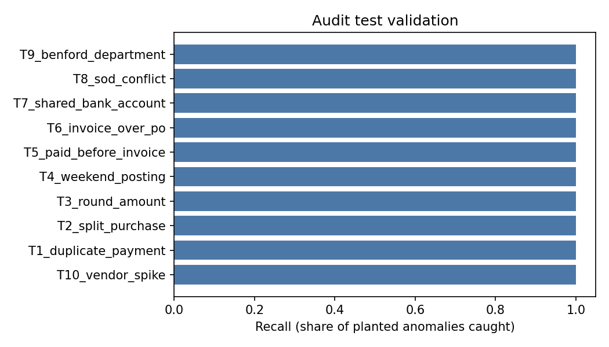
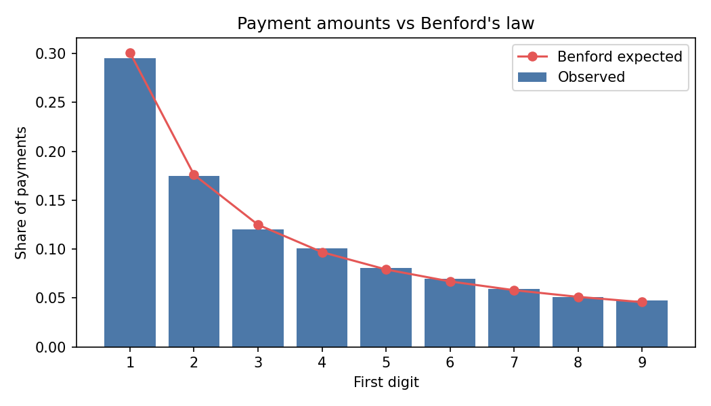

# AuditLens: Procure-to-Pay Spend Leakage and Controls Analytics

AuditLens runs 10 internal-audit tests on a company's purchase-to-payment data. It flags control failures and fraud red flags, ranks vendors by risk, and drafts audit findings in the internal-audit 5C format (Condition, Criteria, Cause, Effect, Recommendation).

## Why
Internal audit and risk-advisory teams test every transaction rather than a sample. They look for duplicate payments, split purchases that dodge approval limits, segregation-of-duties breaches, and manipulated amounts. AuditLens automates that full-population testing.

## Data
A simulated ERP ledger of **36,145 records**: 12,057 purchase orders, 12,000 invoices, 12,088 payments, 400 vendors and 40 users, covering April 2025 to April 2026. Exactly **381 control failures were planted** (`data/planted_anomalies.csv`), so every test can be checked against known ground truth.

## The 10 tests
| # | Test | Red flag |
|---|------|----------|
| T1 | Same invoice paid twice within 3 days | Duplicate payment |
| T2 | POs just under the INR 1,00,000 approval limit, same vendor and requester, within 7 days | Split purchase |
| T3 | Exact round amounts (multiples of INR 5,000) | Unsupported invoice |
| T4 | Weekend postings | Unauthorised activity |
| T5 | Payment before invoice date | 3-way-match bypass |
| T6 | Invoice more than 5% above PO | Overbilling |
| T7 | Vendors sharing a bank account | Ghost or related vendors |
| T8 | PO creator approved own PO | Segregation of duties |
| T9 | Benford's law first-digit test by department (MAD) | Manipulated amounts |
| T10 | Vendor-month spend spike (robust z-score) | Unusual vendor activity |

## Results
- **All 381 planted anomalies caught** (100% recall), with **96.7% precision** (394 exceptions flagged).
- The 13 extra flags are worth reviewing. For example, 8 duplicate payments happened to fall on weekends, so T4 flagged them too.
- **INR 39.1 lakh of recoverable cost leakage** (0.48% of INR 81.9 crore total spend): INR 25.9 lakh in duplicate payments plus INR 13.2 lakh overbilled above PO. Recovering it flows straight to EBITDA.
- **INR 1.83 crore** of payments flagged for review. **38 vendors** rated high risk.
- Benford's test singled out **Marketing** (MAD 0.0345, nonconformity) while every other department was close or acceptable.
- Recall is high because the anomalies were planted. On real data, false positives need investigation, so every exception is a lead to review, not a conclusion.




## Outputs
- `output/AuditLens_Exception_Register.xlsx`: summary, test validation, exception register, vendor risk, Benford by department, data-quality profile
- `output/AuditLens_Audit_Memo.md`: draft findings in 5C format (optionally polished by an LLM if `OPENAI_API_KEY` is set; every finding needs human review)

## Run
```bash
pip install -r requirements.txt
python generate_ledger.py      # builds data/
python run_audit_tests.py      # tests, validation, exception register, charts
python write_audit_memo.py     # draft audit memo
```

## Next steps
- Run the same tests on a real public payments dataset (for example, city government vendor payments)
- Power BI dashboard on the exception register
- Geocode vendor addresses to flag vendors at residential or out-of-area locations
